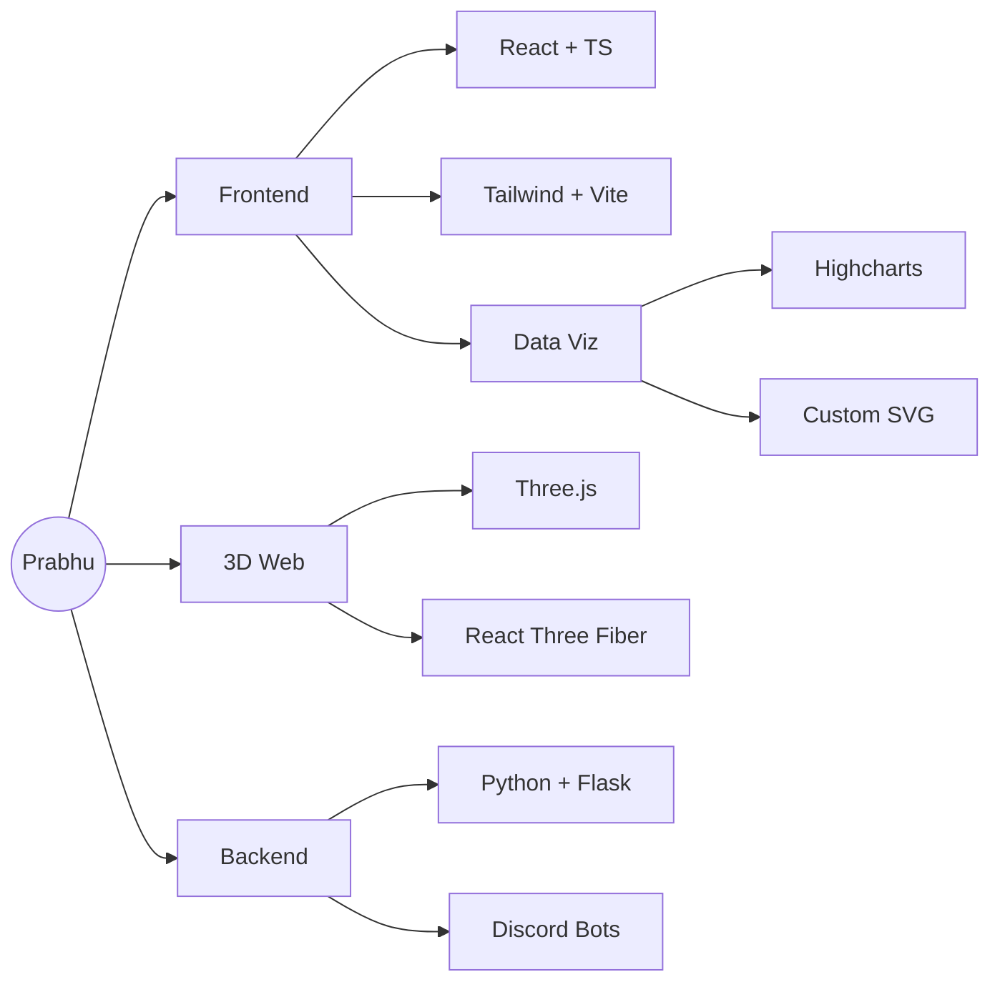

<!-- ═══════════════════════════ HEADER ═══════════════════════════ -->
<p align="center">
  
</p>
<p align="center">
  <a href="#control-panel">
    
  </a>
</p>
<p align="center">
  <a href="https://www.linkedin.com/in/prabhum143/"></a>
  <a href="https://twitter.com/PrabhuMurthy5"></a>
  <a href="https://github.com/PrabhuM143?tab=repositories"></a>
  
</p>
---
 
<a id="control-panel"></a>
## 🎛️ Control Panel
 
<p align="center"><i>Choose a module to jump to it.</i></p>
<p align="center">
  <a href="#whoami"></a>
  <a href="#arsenal"></a>
  <a href="#mission-select"></a>
  <a href="#projects"></a>
  <a href="#telemetry"></a>
  <a href="#terminal"></a>
  <a href="#guestbook"></a>
</p>
---
 
<a id="whoami"></a>
## `$ whoami`
 
```ts
const prabhu = {
  role:        "Frontend Web Developer",
  experience:  "TrioTek",
  core:        ["React", "TypeScript", "Tailwind CSS", "Vite"],
  dimension3D: ["Three.js", "React Three Fiber"],
  backend:     ["Python", "Flask"],
  focus:       ["Data-rich dashboards", "3D web experiences", "Pixel-perfect UI"],
  mission:     "Build interfaces that feel like they shipped from the future.",
};
```
 
---
 
<a id="arsenal"></a>
## ⚡ Tech Arsenal
 
<p align="center">
  <br/><br/>
  
</p>
<p align="center"><i>Click a module to expand its specs.</i></p>
<details>
<summary><b>🧠 Core Frontend</b> · <code>React · TypeScript · Tailwind · Vite</code></summary>
<br/>
- Component-driven architecture with strongly typed props and state
- Responsive layouts with Tailwind (equal-height flex grids, `min-h-0` tricks and all)
- Fast dev loops and lean production builds with Vite
</details>
<details>
<summary><b>📊 Data Visualization</b> · <code>Highcharts · SVG · KPI UI</code></summary>
<br/>
- Heatmaps, history charts and KPI cards for analytics dashboards
- Hand-built **SVG semicircle gauges** with precise arc geometry
- Zoom-driven granularity switching (charts load finer data as you zoom in)
- Skeleton loaders and status-aware score panels
</details>
<details>
<summary><b>🌐 3D & Motion</b> · <code>Three.js · React Three Fiber</code></summary>
<br/>
- Interactive 3D scenes rendered directly in the browser
- Declarative 3D with React Three Fiber
- A fully 3D portfolio: [Prabhu-Portfolio-3D](https://github.com/PrabhuM143/Prabhu-Portfolio-3D)
</details>
<details>
<summary><b>🎨 Design Systems & UX</b> · <code>Carbon · Driver.js</code></summary>
<br/>
- Extending Carbon Design System components with new APIs
- Guided product tours, with progress saved per user and replayable from settings
</details>
<details>
<summary><b>🐍 Backend & Bots</b> · <code>Python · Flask · Discord</code></summary>
<br/>
- REST APIs with Flask
- Discord bots with slash commands: [Valo_Shop_Notify](https://github.com/PrabhuM143/Valo_Shop_Notify)
</details>
---
 
<a id="mission-select"></a>
## 🕹️ Mission Select
 
<p align="center"><i>Who are you, traveler? Pick your path.</i></p>
<details>
<summary><b>🧑‍💼 I'm a recruiter</b></summary>
<br/>
> **TL;DR:** Frontend developer with production experience at **TrioTek**, building React + TypeScript dashboards with complex data visualization. Also works in 3D (Three.js / R3F) and Python/Flask.
>
> 👉 [Connect on LinkedIn](https://www.linkedin.com/in/prabhum143/) · [Browse repositories](https://github.com/PrabhuM143?tab=repositories)
 
</details>
<details>
<summary><b>👨‍💻 I'm a developer</b></summary>
<br/>
> Check out the [3D portfolio source](https://github.com/PrabhuM143/Prabhu-Portfolio-3D) or the [Discord bot](https://github.com/PrabhuM143/Valo_Shop_Notify).
> Stars ⭐, issues and PRs are always welcome.
 
</details>
<details>
<summary><b>🤝 I want to collaborate</b></summary>
<br/>
> I'm open to projects in **frontend, data-viz and 3D web**.
> 👉 [Send a signal](#guestbook) or DM me on [X / Twitter](https://twitter.com/PrabhuMurthy5).
 
</details>
<details>
<summary><b>🎮 I'm just here to vibe</b></summary>
<br/>
> Respect. Watch the snake eat my contributions below 🐍, then [leave a signal](#guestbook) on your way out.
 
</details>
---
 
<a id="projects"></a>
## 🚀 Featured Projects
 
<p align="center">
  <a href="https://github.com/PrabhuM143/Prabhu-Portfolio-3D">
    
  </a>
  <a href="https://github.com/PrabhuM143/Valo_Shop_Notify">
    
  </a>
</p>
<details>
<summary><b>🪐 Prabhu-Portfolio-3D</b>: an interactive 3D portfolio you explore instead of scrolling</summary>
<br/>
**Stack:** Three.js · React Three Fiber · React
**What it shows:** 3D scene composition, camera control and performance-minded rendering on the web.
 
</details>
<details>
<summary><b>🎯 Valo_Shop_Notify</b>: a Discord bot that pings you about your daily Valorant shop</summary>
<br/>
**Stack:** Python · Discord API
**What it shows:** slash commands, authentication flow and scheduled notifications.
 
</details>
<details>
<summary><b>📈 Energy Efficiency Dashboard</b> <i>(work · private)</i></summary>
<br/>
**Stack:** React · TypeScript · Highcharts · Carbon Design System
**What it shows:** heatmaps, SVG gauges, KPI/score panels, history charts, recommendations and a guided product tour.
 
</details>
### 🗺️ Skill Map
 

 
---
 
<a id="telemetry"></a>
## 📡 Telemetry
 
<p align="center">
  
  
</p>
<p align="center">
  
</p>
<details>
<summary><b>📈 Expand the contribution activity graph</b></summary>
<br/>
<p align="center">
  
</p>
</details>
<p align="center">
  <picture>
    <source media="(prefers-color-scheme: dark)" srcset="https://raw.githubusercontent.com/PrabhuM143/PrabhuM143/output/snake-dark.svg" />
    <source media="(prefers-color-scheme: light)" srcset="https://raw.githubusercontent.com/PrabhuM143/PrabhuM143/output/snake.svg" />
    
  </picture>
</p>
---
 
<a id="terminal"></a>
## 💻 Terminal: Ask Me Anything
 
<p align="center"><i>Run a command (click it) to see the output.</i></p>
<details>
<summary><code>$ prabhu --current-focus</code></summary>
```bash
> Shipping production dashboards with React + TypeScript
> Pushing 3D on the web further with React Three Fiber
> Leveling up as a fullstack developer
```
</details>
<details>
<summary><code>$ prabhu --favorite-stack</code></summary>
```bash
> React + TypeScript + Tailwind + Vite
> Fast to build, safe to refactor, easy on the eyes.
```
</details>
<details>
<summary><code>$ prabhu --fun-fact</code></summary>
```bash
> I built a bot so I never miss a good Valorant shop again. 🎯
```
</details>
<details>
<summary><code>$ prabhu --hire</code></summary>
```bash
> Status: OPEN TO OPPORTUNITIES ✅
> Channel: https://www.linkedin.com/in/prabhum143/
```
</details>
---
 
<a id="guestbook"></a>
## 📨 Send a Signal
 
<p align="center">
  Passing through? Leave a message in my guestbook. It opens a pre-filled GitHub issue.<br/><br/>
  <a href="https://github.com/PrabhuM143/PrabhuM143/issues/new?title=%F0%9F%93%A1+Signal+received+from+%5Byour+name%5D&body=Hey+Prabhu%21+%F0%9F%91%8B%0A%0A%3C%21--+Write+your+message+here+--%3E">
    
  </a>
  <a href="https://github.com/PrabhuM143/PrabhuM143/issues">
    
  </a>
</p>
---
 
<p align="center">
  
</p>
<p align="center">
  <a href="#control-panel"></a>
</p>
<p align="center">
  
</p>
 
