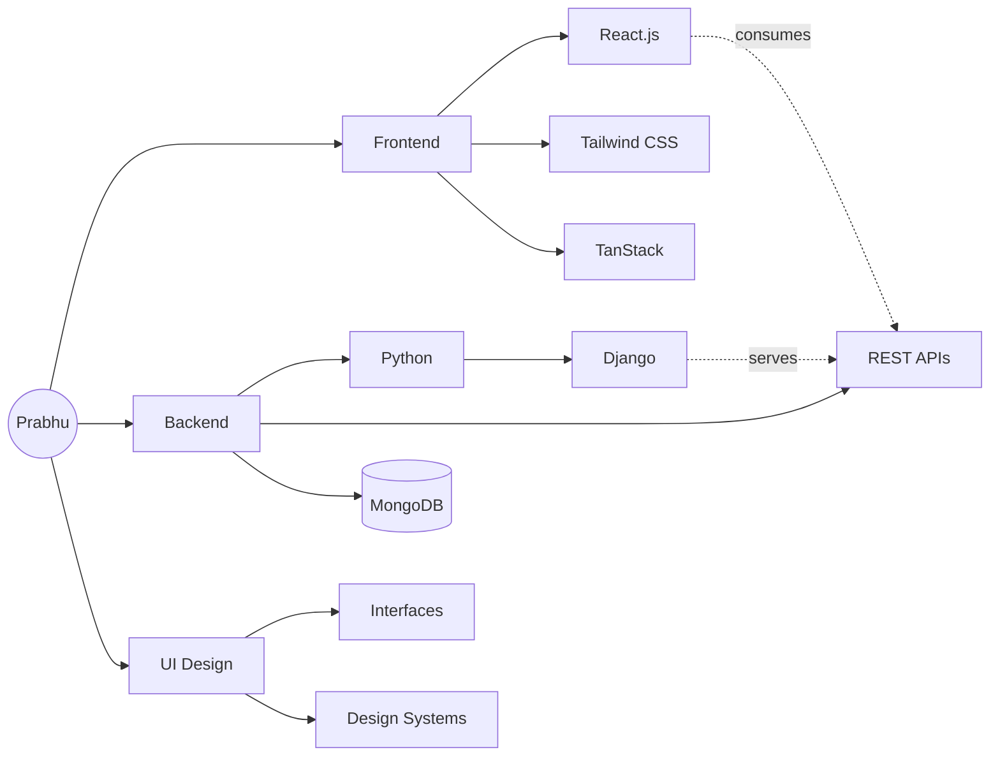

<!-- ═══════════════════════════ HEADER ═══════════════════════════ -->
<p align="center">
  
</p>

<p align="center">
  <a href="#control-panel">
    
  </a>
</p>

<p align="center">
  <a href="https://www.linkedin.com/in/prabhum143/"></a>
  <a href="https://twitter.com/PrabhuMurthy5"></a>
  
</p>

---

<a id="control-panel"></a>
## 🎛️ Control Panel

<p align="center"><i>Choose a module to jump to it.</i></p>

<p align="center">
  <a href="#whoami"></a>
  <a href="#arsenal"></a>
  <a href="#skill-map"></a>
  <a href="#telemetry"></a>
  <a href="#guestbook"></a>
</p>

---

<a id="whoami"></a>
## `$ whoami`

```ts
const prabhu = {
  role:       "Fullstack Engineer",
  experience: "2+ years",
  frontend:   ["React.js", "Tailwind CSS", "TanStack"],
  backend:    ["Python", "Django", "REST APIs", "MongoDB"],
  design:     "UI Designer",
  projects:   ["IoTWatt", "MyESG", "QMS"],
  mission:    "Build end-to-end products that look as good as they work.",
};
```

---

<a id="arsenal"></a>
## ⚡ Tech Arsenal

<p align="center">
  
</p>

<p align="center">
  
  
  
  
  
  
  
</p>

<p align="center"><i>Click a module to expand its specs.</i></p>

<details>
<summary><b>🧠 Frontend</b> · <code>React.js · Tailwind CSS · TanStack</code></summary>
<br/>

- Component-driven React apps with clean, reusable architecture
- Responsive, consistent layouts with Tailwind CSS
- Server state, caching and data tables with TanStack
- Data-rich dashboards with charts, KPI cards and heatmaps

</details>

<details>
<summary><b>🐍 Backend</b> · <code>Python · Django · REST APIs · MongoDB</code></summary>
<br/>

- Backend services and business logic in Python and Django
- Designing and consuming RESTful APIs
- Data modeling and storage with MongoDB

</details>

<details>
<summary><b>🎨 UI Design</b> · <code>Interfaces · Design Systems · UX</code></summary>
<br/>

- Designing clean, intuitive interfaces from idea to implementation
- Building consistent component systems shared across products
- Turning complex data into screens that are easy to read

</details>

<details>
<summary><b>🛰️ Products I've Worked On</b> · <code>IoTWatt · MyESG · QMS</code></summary>
<br/>

- **IoTWatt**
- **MyESG**
- **QMS**

</details>

---

<a id="skill-map"></a>
## 🗺️ Skill Map



---

<a id="telemetry"></a>
## 📡 Telemetry

<p align="center">
  
</p>

<details>
<summary><b>📈 Expand the contribution activity graph</b></summary>
<br/>
<p align="center">
  
</p>
</details>

<p align="center">
  <picture>
    <source media="(prefers-color-scheme: dark)" srcset="https://raw.githubusercontent.com/PrabhuM143/PrabhuM143/output/snake-dark.svg" />
    <source media="(prefers-color-scheme: light)" srcset="https://raw.githubusercontent.com/PrabhuM143/PrabhuM143/output/snake.svg" />
    
  </picture>
</p>

---

<a id="guestbook"></a>
## 📨 Send a Signal

<p align="center">
  Passing through? Leave a message in my guestbook. It opens a pre-filled GitHub issue.<br/><br/>
  <a href="https://github.com/PrabhuM143/PrabhuM143/issues/new?title=%F0%9F%93%A1+Signal+received+from+%5Byour+name%5D&body=Hey+Prabhu%21+%F0%9F%91%8B%0A%0A%3C%21--+Write+your+message+here+--%3E">
    
  </a>
  <a href="https://github.com/PrabhuM143/PrabhuM143/issues">
    
  </a>
</p>

---

<p align="center">
  
</p>

<p align="center">
  <a href="#control-panel"></a>
</p>

<p align="center">
  
</p>
